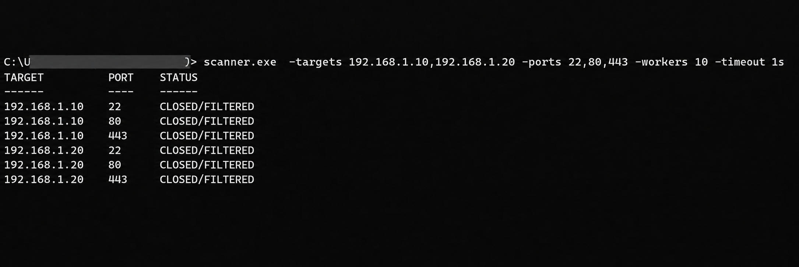

# skanner

skanner is a simple TCP port scanner written in Go.


## Usage

To build, run `go build` in the project directory.

To run, run `skanner -h` for usage information.

Example:

```
skanner -targets 127.0.0.1,192.168.1.1 -ports 22,80,443,1-1024 -timeout 500ms -workers 100
```

## Output

The program will output a list of open ports to the console (by default).

